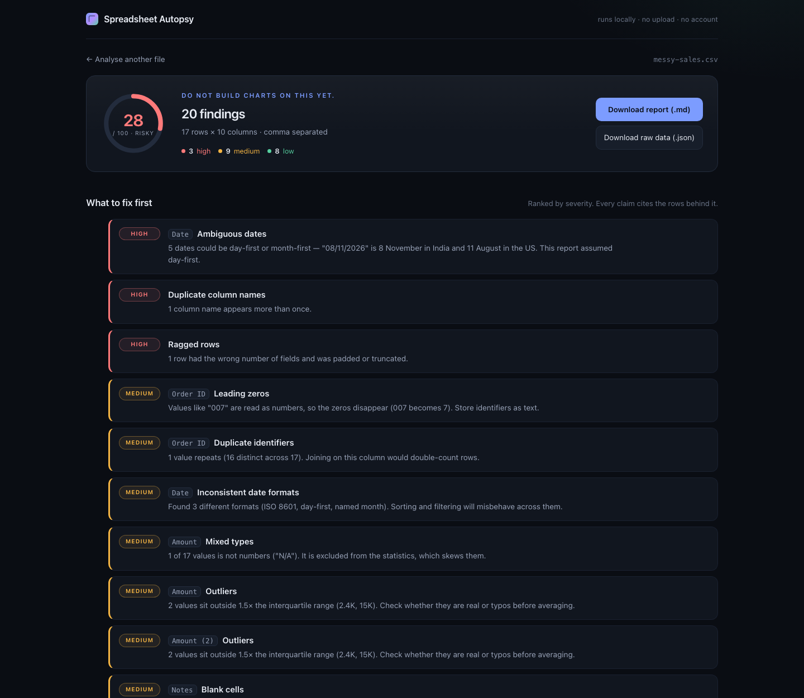

# Spreadsheet Autopsy

Drop a messy CSV in and get a plain-English report on what is wrong with it: blank cells, mixed types, duplicate rows, ambiguous dates, outliers and identifier traps — with the row counts behind every claim.

Everything runs in the browser. No upload, no account, no API key, no backend.



```
Messy sales export  →  28 / 100 (risky)
                       3 high · 9 medium · 8 low
```

## What it checks

| Check | Example it catches |
| --- | --- |
| Type inference per column | `Amount` that is 94% numbers and one `N/A` |
| Mixed types | `11/11/2026` sitting inside a numeric column |
| Blank cells | `Notes` empty in 41% of rows |
| Duplicate rows | The same order exported twice |
| Duplicate identifiers | Three rows sharing `Order ID` 7 |
| Ambiguous dates | `08/11/2026` — 8 November or 11 August? |
| Inconsistent date formats | ISO and day-first in the same column |
| Outliers | Values outside 1.5× the interquartile range |
| Leading zeros | `007` silently becoming `7` |
| Number formatting | `$1,200` next to `1200` next to `(300)` |
| Structural damage | Duplicate headers, ragged rows, unclosed quotes |

Each column gets an inferred type, a distribution chart, and its own findings. The
whole report downloads as Markdown or JSON.

## Run it

Requires **Node 20 or newer** (built and verified on Node 24.18.1, npm 11.16.0).

```bash
git clone <your-repository-url>
cd spreadsheet-autopsy
npm ci
npm run dev
```

Open the URL printed in the terminal — normally <http://localhost:5173>.

There is **no `.env` file, no database and no external service**. `npm ci` is the
only setup step. If `npm ci` complains about a missing lockfile, use `npm install`.

### Other commands

```bash
npm test        # 41 unit tests (parser, value parsing, analysis, fixtures)
npm run build   # type-check, then build to dist/
npm run preview # serve the production build locally
```

## Deploy

Vercel detects Vite automatically. Either import the repository at
[vercel.com/new](https://vercel.com/new), or from the project root:

```bash
npx vercel --prod
```

Build command `npm run build`, output directory `dist` — already pinned in
`vercel.json`. Netlify works with the same values. Avoid free-tier hosts that
sleep on idle: a reviewer's first click should not be a cold start.

## How it works

**Parsing (`src/lib/csv.ts`).** A character-by-character state machine rather
than `split(',')`, because exports contain quoted commas, doubled quotes, CRLF
endings, byte-order marks and newlines inside fields. Delimiters are detected
from the first record, so `;` and tab exports work too.

**Typing (`src/lib/values.ts`, `src/lib/analyze.ts`).** Every non-blank value is
offered to the number, date and boolean parsers. A column takes the type that
covers it; values that do not fit are reported rather than discarded. Numbers
accept `1,200`, `$1,450.50`, `(300)` and `12%`; dates accept ISO, day-first,
month-first, year-first and named months.

**Findings and score (`src/lib/analyze.ts`).** Checks run per column and per
table. Each finding has a severity and a sentence citing the count behind it.
The score starts at 100 and subtracts a fixed weight per finding (8 / 4 / 1.5),
clamped to zero — so it is reproducible and explainable, not a vibe.

**No model is involved anywhere.** The same file always produces the same
report, which is what makes the exported JSON trustworthy.

```
src/
  lib/
    csv.ts        parser + delimiter detection
    values.ts     number, date and boolean parsing
    analyze.ts    inference, checks, scoring, report shape
    export.ts     Markdown and JSON export
    samples.ts    bundled fixtures
  components/     dropzone, findings, charts, column cards
  samples/        messy-sales.csv, clean-customers.csv
```

## Try it without a file

The landing page has two bundled fixtures. `Messy sales export` deliberately
contains a byte-order mark, CRLF endings, quoted commas, a newline inside a
quoted field, a ragged row, a duplicate header, duplicate rows, an ambiguous
date and an outlier. `Clean customer list` scores 100.

A sample can also be opened directly:
`/?sample=messy-sales.csv` or `/?sample=clean-customers.csv`.

## Tests

The 41 tests cover the parts that are easy to get quietly wrong:

- quoted commas, doubled quotes, embedded newlines, BOM, CRLF, ragged rows,
  duplicate headers, delimiter detection (`src/lib/csv.test.ts`)
- currency, thousand separators, parenthesised negatives, percentages,
  day-first vs month-first dates, impossible dates
  (`src/lib/values.test.ts`)
- type inference, mixed types, duplicate rows, outliers, ambiguous dates,
  leading zeros, empty columns, blank thresholds (`src/lib/analyze.test.ts`)
- both bundled fixtures, including the assertion that the clean one scores
  exactly 100 and the messy one trips every headline check
  (`src/lib/samples.test.ts`)

## Limits

- **CSV/TSV/text only.** `.xlsx` is a zip of XML and needs a binary parser; not
  in scope.
- **First 20,000 rows are analysed.** The rest are ignored, and the report says
  so rather than pretending otherwise.
- **Day-first by default.** When both day and month are ≤ 12 the order is
  genuinely unknowable from the file, so it is flagged rather than guessed
  silently.
- **No persistence.** Refresh and the report is gone — nothing is stored.
- **Lexical, not semantic.** It knows a column is numeric; it cannot know the
  numbers are revenue and that negatives are refunds.
- **US-style numbers.** `1,200.50` parses; `1.200,50` (many European exports)
  will not, though semicolon-delimited files do parse.

## Built with AI, documented honestly

The prompts, the bugs the assistant introduced, and the approaches rejected along
the way are recorded in [`NOTES.md`](./NOTES.md).
